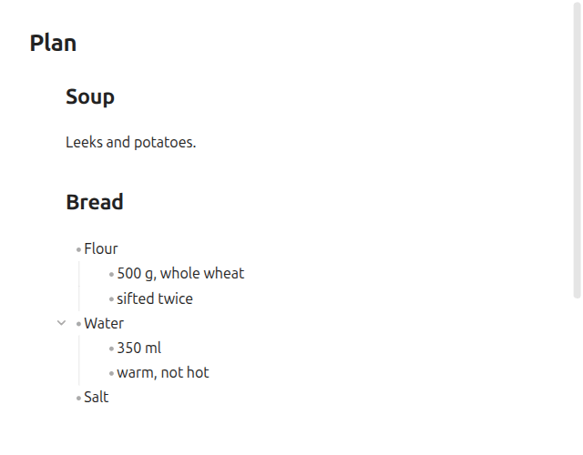

# Heading Reorder

**Move a heading or a bullet with everything under it.**

- Hover a heading: two arrows in the margin swap it with the section above or below.
- `Shift+Alt+↑` and `Shift+Alt+↓` do the same for the heading or bullet the cursor is in.

<picture><source media="(prefers-color-scheme: dark)" srcset="docs/reorder-dark.gif"></picture>

Obsidian's own `Alt+↑` moves one line and leaves the children behind.

## Install

Copy `main.js`, `manifest.json` and `styles.css` into `<vault>/.obsidian/plugins/heading-reorder/`, or add this repo to [BRAT](https://github.com/TfTHacker/obsidian42-brat).

## What moves

- A heading takes its subheadings and swaps with the next heading at the same level.
- A bullet takes everything indented under it and swaps with the next bullet at the same indent.
- Neither leaves its parent. Numbered lists keep their numbers, and what was collapsed stays collapsed.

Keyboard, settings and tests: [docs/usage.md](docs/usage.md).
