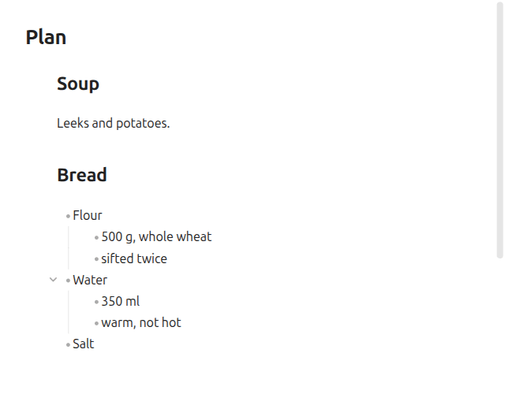

# Heading Reorder

**Move a heading or a bullet with everything under it.**

- Hover a heading: two arrows in the margin swap it with the section above or below.
- `Alt+↑` and `Alt+↓` do the same for the heading or bullet the cursor is in.
- `Shift+Alt+↑` and `Shift+Alt+↓` move only the line, leaving what is under it in place.
- On a bullet, `Ctrl+Tab` indents only the line, leaving what is under it in place, and `Ctrl+Shift+Tab` unindents as `Shift+Tab` does. Anywhere else they still switch tabs.
- `Shift+Tab` on the first bullet of a list brings its children back too. Indented with nothing above it, Markdown reads that bullet as code, and Obsidian moves the line alone.

<picture><source media="(prefers-color-scheme: dark)" srcset="docs/reorder-dark.gif"></picture>

If you bound `Alt+↑/↓` to Obsidian's "Move line up/down", remove that binding: yours wins over the plugin's.

Obsidian's "Go to next tab" and "Go to previous tab" win over a plugin's `Ctrl+Tab`. Set them to `Ctrl+PageDown` and `Ctrl+PageUp` alone in Settings > Hotkeys; the plugin switches tabs on `Ctrl+Tab` itself.

## Install

Copy `main.js`, `manifest.json` and `styles.css` into `<vault>/.obsidian/plugins/heading-reorder/`, or add this repo to [BRAT](https://github.com/TfTHacker/obsidian42-brat).

## What moves

- A heading takes its subheadings and swaps with the next heading at the same level.
- A bullet takes everything indented under it and swaps with the next bullet at the same indent.
- Neither leaves its parent. Numbered lists keep their numbers, and what was collapsed stays collapsed.

Keyboard, settings and tests: [docs/usage.md](docs/usage.md).
